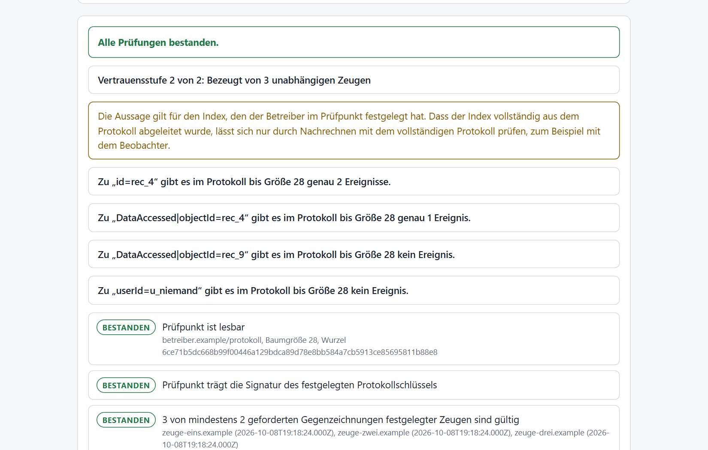
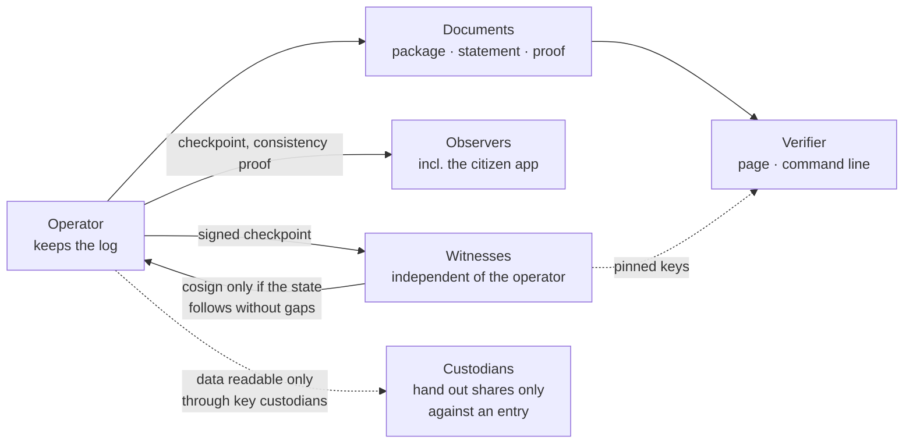

<div align="center">

<picture>
  <source media="(prefers-color-scheme: dark)" srcset="docs/assets/defconder-logo-dunkel.svg">
  
</picture>

# Verifier

**Verify, do not trust.** Open tools to check claims about a tamper-evident log without the application behind it: in the browser, on the command line, and in three implementations.

[](https://github.com/defconder/pruefer/actions/workflows/tests.yml)
[](LICENSE)


-0a6e8f)


[Quick start](#quick-start) · [Document types](#document-types) · [How it works](#how-it-works) · [Specification](pruefer/SPECIFICATION.en.md) · [Threat model](pruefer/THREAT_MODEL.en.md) · [Deutsch](README.md)

</div>

---

## What this is

Whoever keeps a log can rewrite it, and a checksum published by the same party proves little. The verifier recomputes everything itself and says with every result how far it carries. It needs neither a network nor the application the document came from. The page is technically forbidden from opening any connection, a Content-Security-Policy enforces that.

The method comes from certificate and software supply chain transparency: a Merkle tree per RFC 9162, signed checkpoints, and independent witnesses that only cosign a new state if it follows from the old one without gaps. Further building blocks sit on top: proofs for what is **not** in the log, decision proofs against published rules, extracts that hide fields without breaking the hash, a signature a future quantum computer cannot forge, a time proof via Bitcoin, audit samples with public randomness and a release of keys only against an entry in the log.

Identifiers in the code, the field names of the specification and, for now, the page and the command line are German. The English documents are translations of the German ones, which are authoritative.

## What it looks like

<picture>
  <source media="(prefers-color-scheme: dark)" srcset="docs/bilder/pruefer-ergebnis-dunkel.png">
  
</picture>

## Trust levels

| Level | Meaning | What it takes |
|:---:|---|---|
| **0** | The document is internally consistent and unchanged since it was made. | nothing |
| **1** | It comes from the holder of a key you obtained through another channel. | pin the key id or the log key |
| **2** | Independent witnesses have confirmed the log state the document relies on. | pin the log key, the witness keys and a threshold |

Level 0 does **not** prove who made a document, because a document brings its own key. The verifier says so in every result. `--mindeststufe` makes a document fail below a level you demand. Independently of the level you can also demand a hash-based signature of the log (`--log-schluessel-pq`).

## Document types

| Document | It proves |
|---|---|
| **Evidence package** | A file and all its events, analyses and proofs are unchanged. Single events can be included as an extract with hidden fields. |
| **Statement about the log** | "There are exactly these events for this key" or "there are none", for example: this record was never accessed. |
| **Count statement** (statement under index rules 2) | "In October there were exactly N accesses of this kind", without showing the events. |
| **Decision proof** | An access decision matched a rule that was published in the log beforehand. |
| **Contradiction proof** | The log signed two different roots for the same size. Anyone can recompute that. |
| **Time proof** | A checkpoint existed at the latest at a Bitcoin block time. Together with the time anchor this gives a time corridor. |
| **Audit sample** | Events were drawn from the log with the randomness of a later Bitcoin block and checked. Result: with the chosen certainty the share of violating events is below a stated bound. |
| **Release proof and release report** | A key was only handed out after the request stood in the log. The report shows that no key could be released for an object. |
| **Renewal** | A checkpoint was renewed under a second scheme before the first one counts as broken. |
| **Release of the verifier** | The page `pruefer.html` comes from the holders of the release keys (Ed25519 and hash-based). |
| **Checkpoint** | The signed and cosigned state, possibly with index, time anchor and hash-based signature. |

## How it works



**Merkle tree and consistency.** Every event is a leaf. An inclusion proof shows an event is in the tree, a consistency proof that a larger tree contains the smaller one unchanged (RFC 6962, RFC 9162).

**Witnesses and observers.** A witness remembers the last state and only cosigns if the new one builds on it without gaps. An observer fetches checkpoints continuously and raises an alarm on rollback, rewriting or two different roots for one size. The last one is a proof anyone can recompute.

**Field tree and extracts.** An event is a tree of its fields, each with its own salt. The hash only depends on the root. To show a field you reveal its salt, the others stay hidden as leaf hashes and the event remains verifiable in the log.

**Index, proof of absence and count proofs.** For every key (user, record, event type, month) the operator keeps a chain of the matching events with their count. The keys sit sorted in a second tree whose root is signed in the checkpoint. "No event" is proven by two adjacent entries the key does not fall between, a number by the leaf of the key.

**Rules and receipts.** Rules of a small rule language are published as an event before they are applied. A receipt names rule, inputs and result, and the verifier evaluates the rule itself, including all edge cases.

**Hash-based signature.** In addition to Ed25519 the log can sign its checkpoint with SLH-DSA per FIPS 205. The scheme only needs SHA-256, and the verifier recomputes it in the browser without an extra package. Our implementation produces signatures that match an independent reference byte for byte.

**Time corridor.** A checkpoint can carry the header of the latest Bitcoin block (lower bound: not earlier than). A time proof in the OpenTimestamps format shows it existed at the latest at a later block time (upper bound). That protects even if someone forges a signature later: a checkpoint created afterwards cannot catch up on this proof. Renewal uses it to keep evidential value beyond the break of a scheme.

**Audit sample with public randomness.** Some things cannot be proven without gaps, for example that every decision followed the rule. The randomness for the selection comes from a Bitcoin block found after the checkpoint was committed. The operator cannot foresee it, the auditor cannot steer it. If the sample finds no violation, the verifier states a bound: with 400 error-free draws and 95 percent certainty the share of violating events is below 0.75 percent. A sample does not find single rare violations, and the report says so.

**Release only against a log entry.** A log only proves what is in it. An access that was never entered stays invisible. If the data lies encrypted and its key is shared among several key custodians, a custodian hands out its share only if the request stands in the log of a checkpoint confirmed by witnesses. Whoever decrypted has left an entry, and a proof of absence then also means something about the access itself. A reference custodian is in [`hueter`](hueter/README.en.md).

## Related work

The building blocks come from the transparency community: Certificate Transparency and RFC 9162, Go sumdb, Sigstore, Sigsum, the [C2SP](https://c2sp.org) formats and the [transparency.dev](https://transparency.dev) witness network.

- **Index and proof of absence.** The closest related work is the verifiable index (vindex) in the transparency-dev incubator, which uses a prefix trie based on AKD, plus the key transparency literature (CONIKS, AKD). Proofs of absence are standard for prefix tries, so they are not a distinguishing feature of ours. We use a plain sorted tree, which is easier to implement and verify, costs more to update and has no incremental update proof. An observer recomputes the index from the full log. It is not meant for very large logs.
- **Release against a log entry.** The idea of handing out key shares only against an entry in a transparency log is in the research literature, for example [arXiv 2303.04500](https://arxiv.org/abs/2303.04500). We do not know of an open verifier that combines it with proofs of absence, but it is not ruled out that one exists.
- **Audit samples with public randomness.** The method comes from election auditing (risk-limiting audits with public randomness). We do not know of a combination with a transparency log.
- **Time proof.** [OpenTimestamps](https://opentimestamps.org) provides the format, we read and verify it ourselves.

Where we differ from these works or overlooked something, we are grateful for pointers.

## Quick start

Requires Node 20 or later. No installation, no dependencies:

```bash
git clone https://github.com/defconder/pruefer.git && cd pruefer/pruefer

node pruefer.mjs package.json original.pdf --bericht
node pruefer.mjs aussage statement.json --log-schluessel "operator.example/log+1a2b3c4d+AQ..." --zeugen-datei witnesses.txt --mindeststufe 2
node pruefer.mjs aussage statement.json --log-schluessel "..." --log-schluessel-pq "operator.example/log+9f8e7d6c+/w..."
node pruefer.mjs entscheidung proof.json --log-schluessel "..." --bericht
node pruefer.mjs zeitbeweis timeproof.json --log-schluessel "..." --bericht
node pruefer.mjs stichprobe sample.json --log-schluessel "..." --zeugen-datei witnesses.txt --mindestanzahl 400 --bericht
node pruefer.mjs freigabe release.json --log-schluessel "..." --zeugen-datei witnesses.txt --hueter-datei custodians.txt --hueter-schwelle 2
node pruefer.mjs freigabebericht report.json --hueter-datei custodians.txt --hueter-schwelle 2 --bericht
node pruefer.mjs erneuerung renewal.json --log-schluessel "..." --erneuerungs-schluessel "..." --bruch ed25519=2035-01-01
node pruefer.mjs widerspruch proof.json --log-schluessel "..."
node pruefer.mjs pruefpunkt checkpoint.txt --log-schluessel "..." --zeugen-datei witnesses.txt
```

Or open `pruefer/pruefer.html` in a browser. Exit code 0 means passed, 1 failed, 2 bad usage.

Start a witness, an observer or a custodian:

```bash
node zeuge/zeuge.mjs --name witness.example.org --log "<log key>" --port 8801
node beobachter/beobachter.mjs --quelle https://operator.example --log "<key>" --zeuge "<witness key>" --schwelle 1
node hueter/hueter.mjs --name custodian-1.example.org --log "<key>" --zeuge "<witness key>" --zeugen-schwelle 1 --anteil object-1=<share in Base64>
```

A time proof is built with the `ots` tool from OpenTimestamps and `pruefer/zeitbeweis-bauen.mjs`, see the help of the tool.

## Three implementations, one set of test vectors

The verifier exists in JavaScript, Python and Rust, all three written against the specification. All pass the same test vectors: tree roots, more than three hundred consistency proofs, checkpoints with valid, missing and forged signatures, events of both formats with modifications, extracts, statements, time anchors, receipts, hash-based signatures (the vectors come from an independent reference), OpenTimestamps proofs including a real proof from 2015 with its Bitcoin block, the drawing of the audit sample and index rules 2.

```bash
node pruefer/testvektoren/pruefen.mjs
python pruefer/python/pruefen_vektoren.py
cargo run --release --manifest-path pruefer/rust/Cargo.toml -- pruefer/testvektoren/testvektoren.json
```

The full verification of the documents time proof, audit sample, release proof, renewal and release exists only in JavaScript so far. The formats are described precisely enough to rebuild the verifier in a fourth language: [Specification](pruefer/SPECIFICATION.en.md).

## Is the page I am using genuine?

`pruefer/ausgabe/MANIFEST.json` holds the hash of `pruefer.html` and of the list of all files, signed with Ed25519 and hash-based (SLH-DSA). The page is built reproducibly, building twice gives the same hash. This is how you check your copy:

```bash
node pruefer/pruefer.mjs release pruefer/ausgabe/MANIFEST.json \
  --release-schluessel "defconder-pruefer-release+c7ba8bac+AQyTGFTl5p5ofGZRuKPu7XwizEt15NVYzzpt0xkePoRC" \
  --release-schluessel "defconder-pruefer-release+d5653f5c+/2RlZmNvbmRlci1zbGgtZHNhLXNoYTItMTI4cy0xACZ1e6CVXF+/0JZlAk/fTRrIjhp/z2M0iSY3ECh0X6nL" \
  --datei pruefer/pruefer.html --summen pruefer/ausgabe/SHA256SUMS
```

The keys stand here in the same repository as the manifest. Whoever wants to be sure compares them with a second source, for example the announcement of the release. There is no attestation of the release by independent third parties yet.

## Limits

- There has been **no independent security audit**. The verifier is small, has no runtime dependencies and is tested against three implementations. That does not replace an audit.
- The three implementations are by the same author. They find mistakes in the specification and edge cases, but do not replace an implementation by third parties.
- Level 2 is only as strong as the **independence of the witnesses**, which you judge, not the verifier. Witnesses trust the operator for the very first state.
- The witnesses' cosignatures are Ed25519 and therefore not quantum-safe. The log itself, the release and the links of a renewal can sign hash-based. For cosignatures C2SP knows the type 0x06 with ML-DSA-44, which the verifier does not check.
- There is **no eIDAS qualified timestamp**. The Bitcoin time anchor proves "not earlier than", the time proof "not later than", both only to about two hours.
- A statement about the log holds for the index the operator fixed. Whether it is complete can only be checked by recomputing it from the full log, for example with the observer. The index has no incremental update proof and is meant for small to medium logs.
- A decision proof shows the published rule was applied, not that inputs or rule are factually right.
- An audit sample does not find single rare violations and only holds for witnessed checkpoints.
- Release against a log entry only helps for data that goes through key custodians. Whoever brings `k` custodians to their side decrypts without an entry, and whoever has the plaintext can copy it. The entry only appears in the next confirmed checkpoint, which costs time. The reference custodian is a model, not a hardened service.
- The verifier page and the command line speak German only so far. The documents (this page, specification, threat model, security notes) exist in German and English.
- Legal effect in court is not the subject of this tool.

## Witnesses, observers and custodians wanted

The verifier only becomes strong when third parties take part. Anyone who wants to run a witness or an observer, as an organisation, supervisory body, research group or individual, finds what is needed in [`zeuge`](zeuge/README.en.md) and [`beobachter`](beobachter/README.en.md), for key custodians there is [`hueter`](hueter/README.en.md). Bugs, gaps in the specification and independent implementations are welcome, see [CONTRIBUTING.md](CONTRIBUTING.md).

## Security and licence

Please report vulnerabilities confidentially, see [SECURITY.md](SECURITY.md). Licence: [Apache-2.0](LICENSE).

<div align="center">

Part of **Defconder**, a sovereign situational awareness and command layer. [defconder.com](https://defconder.com)

</div>
