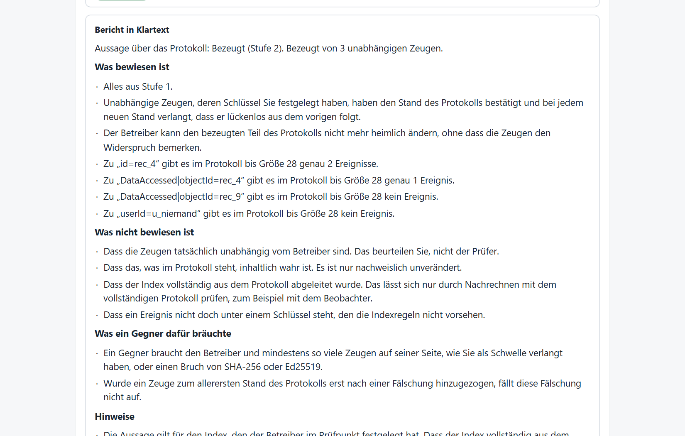
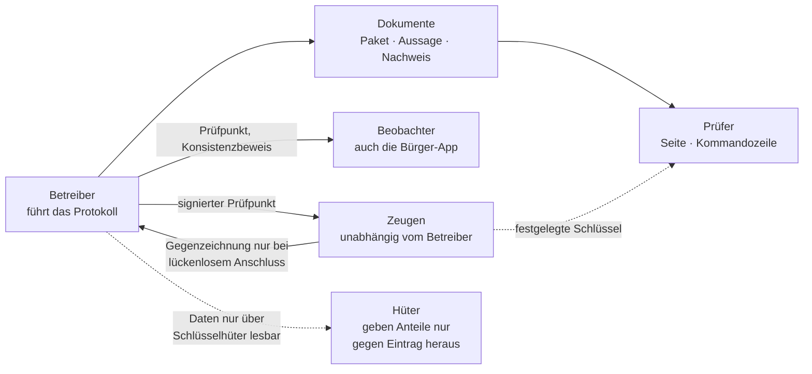

<div align="center">

<picture>
  <source media="(prefers-color-scheme: dark)" srcset="docs/assets/defconder-logo-dunkel.svg">
  
</picture>

# Prüfer

**Nachprüfen, statt zu glauben.** Offene Werkzeuge, mit denen sich Aussagen über ein manipulationssicheres Protokoll ohne die Anwendung dahinter überprüfen lassen: im Browser, auf der Kommandozeile und in drei Umsetzungen.

[](https://github.com/defconder/pruefer/actions/workflows/tests.yml)
[](LICENSE)


-0a6e8f)


[Schnellstart](#schnellstart) · [Dokumentarten](#dokumentarten) · [Funktionsweise](#funktionsweise) · [Spezifikation](pruefer/SPEZIFIKATION.md) · [Bedrohungsmodell](pruefer/BEDROHUNGSMODELL.md) · [English](README.en.md)

</div>

---

## Worum es geht

Wer ein Protokoll führt, kann es umschreiben, und wer eine Prüfsumme veröffentlicht, die er selbst erzeugt hat, beweist damit wenig. Der Prüfer rechnet deshalb alles selbst nach und sagt bei jedem Ergebnis, wie weit es trägt. Er braucht weder Netz noch die Anwendung, aus der das Dokument stammt. Die Seite darf technisch keine Verbindung aufbauen, das erzwingt eine Content-Security-Policy.

Das Verfahren stammt aus der Transparenz-Szene der Zertifikate und Softwarelieferketten: ein Merkle-Baum nach RFC 9162, signierte Prüfpunkte, unabhängige Zeugen, die einen neuen Stand nur gegenzeichnen, wenn er lückenlos aus dem alten folgt. Darauf setzen weitere Bausteine auf: Beweise für das, was **nicht** im Protokoll steht, Entscheidungsnachweise gegen veröffentlichte Regeln, Auszüge, die Felder verdecken, ohne die Prüfsumme zu brechen, eine Signatur, die auch ein künftiger Quantencomputer nicht fälscht, ein Zeitbeweis über Bitcoin, Stichproben mit öffentlichem Zufall und eine Freigabe von Schlüsseln nur gegen einen Eintrag im Protokoll.

## So sieht es aus

<picture>
  <source media="(prefers-color-scheme: dark)" srcset="docs/bilder/pruefer-ergebnis-dunkel.png">
  
</picture>

Jedes Ergebnis kommt mit einem Bericht in Klartext: was bewiesen ist, was nicht, was ein Gegner dafür bräuchte und was als Nächstes zu tun ist.

<picture>
  <source media="(prefers-color-scheme: dark)" srcset="docs/bilder/pruefer-bericht-dunkel.png">
  
</picture>

## Vertrauensstufen

| Stufe | Bedeutung | Was dafür nötig ist |
|:---:|---|---|
| **0** | Das Dokument ist in sich stimmig und seit seiner Erstellung unverändert. | nichts |
| **1** | Es stammt vom Inhaber eines Schlüssels, den Sie auf anderem Weg erhalten haben. | Schlüsselkennung oder Protokollschlüssel festlegen |
| **2** | Unabhängige Zeugen haben den Stand des Protokolls bestätigt, den das Dokument voraussetzt. | Protokollschlüssel, Zeugenschlüssel und eine Schwelle festlegen |

Stufe 0 beweist **nicht**, von wem ein Dokument stammt: Ein Dokument bringt seinen eigenen Schlüssel mit. Das schreibt der Prüfer in jedes Ergebnis. Wer mehr verlangt, setzt `--mindeststufe`, dann gilt ein Dokument unterhalb davon als nicht bestanden. Unabhängig von der Stufe lässt sich zusätzlich eine hashbasierte Signatur des Protokolls verlangen (`--log-schluessel-pq`).

## Dokumentarten

| Dokument | Es beweist |
|---|---|
| **Beweispaket** | Eine Datei und alle ihre Ereignisse, Analysen und Beweise sind unverändert. Einzelne Ereignisse können als Auszug mit verdeckten Feldern beiliegen. |
| **Aussage über das Protokoll** | „Zu diesem Schlüssel gibt es genau diese Ereignisse“ oder „es gibt keine“, zum Beispiel: Dieser Datensatz wurde nie abgerufen. |
| **Zählprotokoll** (Aussage unter den Indexregeln 2) | „Im Oktober gab es genau N Zugriffe dieser Art“, ohne die Ereignisse zu zeigen. |
| **Entscheidungsnachweis** | Eine Zugriffsentscheidung entsprach der Regel, die vorher im Protokoll veröffentlicht war. |
| **Widerspruchsbeweis** | Das Protokoll hat für dieselbe Größe zwei verschiedene Wurzeln unterschrieben. Das kann jeder nachrechnen. |
| **Zeitbeweis** | Ein Prüfpunkt bestand spätestens zu einer Bitcoin-Blockzeit. Zusammen mit dem Zeitanker ergibt das einen Zeitkorridor. |
| **Stichprobe** | Aus dem Protokoll wurden mit dem Zufall eines späteren Bitcoin-Blocks Ereignisse gezogen und geprüft. Ergebnis: mit der gewählten Sicherheit liegt der Anteil verletzender Ereignisse unter einer genannten Schranke. |
| **Freigabenachweis und Freigabebericht** | Ein Schlüssel wurde nur herausgegeben, nachdem die Anfrage im Protokoll stand. Der Bericht zeigt, dass für ein Objekt keiner freigegeben werden konnte. |
| **Erneuerung** | Ein Prüfpunkt wurde unter einem zweiten Verfahren erneuert, bevor das erste als gebrochen gilt. |
| **Veröffentlichung** | Die Seite `pruefer.html` stammt von den Inhabern der Veröffentlichungsschlüssel (Ed25519 und hashbasiert). |
| **Prüfpunkt** | Der signierte und gegengezeichnete Stand, gegebenenfalls mit Index, Zeitanker und hashbasierter Signatur. |

## Funktionsweise



**Merkle-Baum und Konsistenz.** Jedes Ereignis ist ein Blatt. Ein Einschlussbeweis zeigt, dass ein Ereignis im Baum steht, ein Konsistenzbeweis, dass ein größerer Baum den kleineren unverändert enthält (RFC 6962, RFC 9162).

**Zeugen und Beobachter.** Ein Zeuge merkt sich den letzten Stand und zeichnet nur gegen, wenn der neue lückenlos darauf aufbaut. Ein Beobachter holt Prüfpunkte laufend und schlägt Alarm bei Rücksetzung, Umschreiben oder zwei verschiedenen Wurzeln für dieselbe Größe. Das Letzte ist ein Beweis, den jeder nachrechnen kann.

**Feldbaum und Auszüge.** Ein Ereignis besteht aus einem Baum seiner Felder, jedes Feld mit eigenem Salz. Die Prüfsumme hängt nur an der Wurzel dieses Baums. Zeigt man ein Feld, legt man dessen Salz offen, die übrigen bleiben als Blattprüfsummen verdeckt und das Ereignis bleibt im Protokoll nachprüfbar.

**Index, Beweis des Fehlenden und Zählbeweise.** Zu jedem Schlüssel (Nutzer, Datensatz, Ereignistyp, Monat) führt der Betreiber eine Kette der zugehörigen Ereignisse samt Anzahl. Die Schlüssel stehen sortiert in einem zweiten Baum, dessen Wurzel im Prüfpunkt mitunterschrieben wird. „Kein Ereignis“ beweist man mit zwei benachbarten Einträgen, zwischen denen der Schlüssel nicht liegt, eine Zahl mit dem Blatt des Schlüssels.

**Regeln und Belege.** Regeln einer kleinen Regelsprache stehen als Ereignis im Protokoll, bevor sie angewandt werden. Ein Beleg nennt Regel, Eingaben und Ergebnis, der Prüfer rechnet die Regel selbst durch, auch alle Randfälle.

**Hashbasierte Signatur.** Zusätzlich zu Ed25519 kann das Protokoll seinen Prüfpunkt mit SLH-DSA nach FIPS 205 unterschreiben. Das Verfahren braucht nur SHA-256, und der Prüfer rechnet es ohne Zusatzpaket im Browser nach. Unsere Umsetzung erzeugt Signaturen, die Byte für Byte mit einer unabhängigen Referenz übereinstimmen.

**Zeitkorridor.** Ein Prüfpunkt kann den Kopf des neuesten Bitcoin-Blocks tragen (Untergrenze: nicht früher als). Ein Zeitbeweis nach OpenTimestamps zeigt, dass er spätestens zu einer späteren Blockzeit bestand (Obergrenze). Das schützt auch dann, wenn jemand später eine Signatur fälscht: Ein nachträglich erzeugter Prüfpunkt kann diesen Beweis nicht nachholen. Die Erneuerung nutzt das, um den Beweiswert über den Bruch eines Verfahrens hinaus zu halten. Ein echtes Beispiel mit Prüfpunkt, Beweis und Blockköpfen liegt in [`beispiele/zeitbeweis`](beispiele/zeitbeweis/README.md).

**Stichprobe mit öffentlichem Zufall.** Manches lässt sich nicht lückenlos beweisen, etwa dass jede Entscheidung der Regel folgte. Der Zufall für die Auswahl stammt aus einem Bitcoin-Block, der nach dem Festschreiben des Prüfpunkts gefunden wurde. Der Betreiber kann ihn nicht vorhersehen, die Aufsicht nicht beeinflussen. Findet die Stichprobe keinen Verstoß, nennt der Prüfer eine Schranke: Mit 400 fehlerfreien Ziehungen und 95 Prozent Sicherheit liegt der Anteil verletzender Ereignisse unter 0,75 Prozent. Einzelne seltene Verstöße findet eine Stichprobe nicht, und der Bericht sagt das.

**Freigabe nur gegen Protokolleintrag.** Ein Protokoll beweist nur, was drinsteht. Ein Zugriff, der nie eingetragen wurde, bleibt unsichtbar. Liegen die Daten verschlüsselt und ist ihr Schlüssel unter mehreren Schlüsselhütern geteilt, gibt ein Hüter seinen Anteil nur heraus, wenn die Anfrage im Protokoll eines von Zeugen bestätigten Prüfpunkts steht. Wer entschlüsselt hat, hat einen Eintrag hinterlassen, und der Beweis des Fehlenden bedeutet dann auch etwas für den Zugriff selbst. Ein Referenz-Hüter liegt in [`hueter`](hueter/README.md).

## Verwandte Arbeiten

Die Bausteine kommen aus der Transparenz-Szene: Certificate Transparency und RFC 9162, Go sumdb, Sigstore, Sigsum, die Formate von [C2SP](https://c2sp.org) und das Zeugennetz von [transparency.dev](https://transparency.dev).

- **Index und Beweis des Fehlenden.** Die engste verwandte Arbeit ist der verifizierbare Index (vindex) im Incubator von transparency-dev, der einen Präfixbaum auf Basis von AKD verwendet, dazu die Literatur zu Schlüsseltransparenz (CONIKS, AKD). Beweise des Fehlenden gehören bei Präfixbäumen zum Standard, sie sind bei uns kein Alleinstellungsmerkmal. Wir benutzen einen einfachen, sortierten Baum, der sich leichter umsetzen und prüfen lässt, beim Aktualisieren mehr kostet und keinen schrittweisen Änderungsbeweis kennt. Ein Beobachter rechnet den Index aus dem ganzen Protokoll nach. Für sehr große Protokolle ist das nicht gedacht.
- **Freigabe gegen Protokolleintrag.** Die Idee, Schlüsselanteile nur gegen einen Eintrag in einem Transparenzprotokoll herauszugeben, steht in der Forschung, zum Beispiel in [arXiv 2303.04500](https://arxiv.org/abs/2303.04500). Uns ist kein offener Prüfer bekannt, der sie mit Beweisen des Fehlenden verbindet, ausgeschlossen ist es nicht.
- **Stichproben mit öffentlichem Zufall.** Die Methode kommt aus der Wahlprüfung (Risk-Limiting Audits mit öffentlicher Zufälligkeit). Uns ist keine Verbindung mit einem Transparenzprotokoll bekannt.
- **Zeitbeweis.** [OpenTimestamps](https://opentimestamps.org) liefert das Format, wir lesen und prüfen es selbst.

Wo wir von diesen Arbeiten abweichen oder etwas übersehen haben, sind wir für Hinweise dankbar.

## Schnellstart

Voraussetzung ist Node ab Version 20. Ohne Installation, ohne Abhängigkeiten:

```bash
git clone https://github.com/defconder/pruefer.git && cd pruefer/pruefer

node pruefer.mjs beweispaket.json original.pdf --bericht
node pruefer.mjs aussage aussage.json --log-schluessel "betreiber.example/log+1a2b3c4d+AQ..." --zeugen-datei zeugen.txt --mindeststufe 2
node pruefer.mjs aussage aussage.json --log-schluessel "..." --log-schluessel-pq "betreiber.example/log+9f8e7d6c+/w..."
node pruefer.mjs entscheidung nachweis.json --log-schluessel "..." --bericht
node pruefer.mjs zeitbeweis zeitbeweis.json --log-schluessel "..." --bericht
node pruefer.mjs stichprobe stichprobe.json --log-schluessel "..." --zeugen-datei zeugen.txt --mindestanzahl 400 --bericht
node pruefer.mjs freigabe freigabe.json --log-schluessel "..." --zeugen-datei zeugen.txt --hueter-datei hueter.txt --hueter-schwelle 2
node pruefer.mjs freigabebericht bericht.json --hueter-datei hueter.txt --hueter-schwelle 2 --bericht
node pruefer.mjs erneuerung erneuerung.json --log-schluessel "..." --erneuerungs-schluessel "..." --bruch ed25519=2035-01-01
node pruefer.mjs widerspruch beweis.json --log-schluessel "..."
node pruefer.mjs pruefpunkt pruefpunkt.txt --log-schluessel "..." --zeugen-datei zeugen.txt
```

Oder `pruefer/pruefer.html` im Browser öffnen. Rückgabewert 0 heißt bestanden, 1 nicht bestanden, 2 fehlerhafter Aufruf.

Einen Zeugen, einen Beobachter oder einen Hüter starten:

```bash
node zeuge/zeuge.mjs --name zeuge.example.org --log "<Schlüssel des Protokolls>" --port 8801
node beobachter/beobachter.mjs --quelle https://betreiber.example --log "<Schlüssel>" --zeuge "<Schlüssel des Zeugen>" --schwelle 1
node hueter/hueter.mjs --name hueter-1.example.org --log "<Schlüssel>" --zeuge "<Schlüssel des Zeugen>" --zeugen-schwelle 1 --anteil objekt-1=<Anteil in Base64>
```

Einen Zeitbeweis baut man mit dem Werkzeug `ots` von OpenTimestamps und `pruefer/zeitbeweis-bauen.mjs`, siehe die Hilfe des Werkzeugs.

## Drei Umsetzungen, ein Satz Testvektoren

Der Prüfer liegt in JavaScript, Python und Rust vor, alle drei gegen die Spezifikation geschrieben. Alle drei bestehen dieselben Testvektoren: Baumwurzeln, mehr als dreihundert Konsistenzbeweise, Prüfpunkte mit gültigen, fehlenden und gefälschten Signaturen, Ereignisse beider Formate mit Veränderungen, Auszüge, Aussagen, Zeitanker, Belege, hashbasierte Signaturen (die Vektoren stammen aus einer unabhängigen Referenz), Beweise von OpenTimestamps einschließlich eines echten Beweises von 2015 samt seinem Bitcoin-Block, die Ziehung der Stichprobe und die Indexregeln 2.

```bash
node pruefer/testvektoren/pruefen.mjs
python pruefer/python/pruefen_vektoren.py
cargo run --release --manifest-path pruefer/rust/Cargo.toml -- pruefer/testvektoren/testvektoren.json
```

Die vollständige Prüfung der Dokumente Zeitbeweis, Stichprobe, Freigabe, Erneuerung und Veröffentlichung gibt es bisher nur in JavaScript. Die Formate sind so genau beschrieben, dass man den Prüfer in einer vierten Sprache nachbauen kann: [Spezifikation](pruefer/SPEZIFIKATION.md) ([English](pruefer/SPECIFICATION.en.md)).

## Ist die Seite, die ich benutze, echt?

`pruefer/ausgabe/MANIFEST.json` enthält die Prüfsumme von `pruefer.html` und der Liste aller Dateien, unterschrieben mit Ed25519 und hashbasiert (SLH-DSA). Die Seite wird reproduzierbar gebaut, zweimal gebaut ergibt dieselbe Prüfsumme. So prüfen Sie Ihre Kopie:

```bash
node pruefer/pruefer.mjs release pruefer/ausgabe/MANIFEST.json \
  --release-schluessel "defconder-pruefer-release+c7ba8bac+AQyTGFTl5p5ofGZRuKPu7XwizEt15NVYzzpt0xkePoRC" \
  --release-schluessel "defconder-pruefer-release+d5653f5c+/2RlZmNvbmRlci1zbGgtZHNhLXNoYTItMTI4cy0xACZ1e6CVXF+/0JZlAk/fTRrIjhp/z2M0iSY3ECh0X6nL" \
  --datei pruefer/pruefer.html --summen pruefer/ausgabe/SHA256SUMS
```

Die Schlüssel stehen hier im selben Repository wie das Manifest. Wer sicher sein will, vergleicht sie mit einer zweiten Quelle, zum Beispiel der Ankündigung der Fassung. Eine Bezeugung der Veröffentlichung durch unabhängige Dritte gibt es noch nicht.

## Grenzen

Das gehört in dieses Dokument, damit niemand mehr hineinliest, als drinsteht.

- Es gab **kein unabhängiges Sicherheitsaudit**. Der Prüfer ist klein, hat keine Laufzeitabhängigkeiten und ist gegen drei Umsetzungen getestet. Das ersetzt kein Audit.
- Die drei Umsetzungen stammen von derselben Hand. Sie finden Fehler in der Spezifikation und in Randfällen, ersetzen aber keine Umsetzung durch Dritte.
- Stufe 2 ist nur so stark wie die **Unabhängigkeit der Zeugen**, und das beurteilen Sie, nicht der Prüfer. Zeugen vertrauen dem Betreiber beim allerersten Stand.
- Die Gegenzeichnungen der Zeugen sind Ed25519 und damit nicht quantensicher. Hashbasiert unterschreiben können das Protokoll selbst, die Veröffentlichung und die Glieder einer Erneuerung. C2SP kennt für Gegenzeichnungen den Typ 0x06 mit ML-DSA-44, den Prüfer nicht prüft.
- Es gibt **keinen qualifizierten Zeitstempel** nach eIDAS. Der Bitcoin-Zeitanker belegt „nicht früher als“, der Zeitbeweis „nicht später als“, beides nur auf etwa zwei Stunden genau.
- Eine Aussage über das Protokoll gilt für den Index, den der Betreiber festgelegt hat. Ob er vollständig ist, lässt sich nur mit dem vollständigen Protokoll nachrechnen, zum Beispiel mit dem Beobachter. Der Index hat keinen schrittweisen Änderungsbeweis und ist für kleine bis mittlere Protokolle gedacht.
- Ein Entscheidungsnachweis zeigt, dass nach der veröffentlichten Regel entschieden wurde, nicht dass Eingaben oder Regel fachlich richtig sind.
- Eine Stichprobe findet einzelne seltene Verstöße nicht und gilt nur für bezeugte Prüfpunkte.
- Die Freigabe gegen Protokolleintrag hilft nur für Daten, die über Schlüsselhüter laufen. Wer `k` Hüter auf seine Seite bringt, entschlüsselt ohne Eintrag, und wer den Klartext hat, kann ihn kopieren. Der Eintrag steht erst im nächsten bezeugten Prüfpunkt, das kostet Zeit. Der Referenz-Hüter ist ein Muster, kein gehärteter Dienst.
- Die Prüferseite und die Kommandozeile sprechen bisher nur Deutsch. Die Dokumente (diese Seite, Spezifikation, Bedrohungsmodell, Sicherheitshinweise) gibt es auf Deutsch und Englisch.
- Rechtliche Wirkung vor Gericht ist nicht Gegenstand dieses Werkzeugs.

Das vollständige [Bedrohungsmodell](pruefer/BEDROHUNGSMODELL.md) benennt für jeden Angreifer und jede Stufe, was abgewehrt wird.

## Zeugen, Beobachter und Hüter gesucht

Der Prüfer wird erst stark, wenn Dritte mitmachen. Wer einen Zeugen betreiben oder einen Beobachter laufen lassen will, ob als Organisation, Aufsicht, Forschungsgruppe oder Einzelperson, findet in [`zeuge`](zeuge/README.md) und [`beobachter`](beobachter/README.md) alles dafür, für Schlüsselhüter gibt es [`hueter`](hueter/README.md). Fehler, Lücken in der Spezifikation und unabhängige Umsetzungen sind ausdrücklich willkommen, siehe [CONTRIBUTING.md](CONTRIBUTING.md).

## Sicherheit und Lizenz

Sicherheitslücken bitte vertraulich melden, siehe [SECURITY.md](SECURITY.md). Lizenz: [Apache-2.0](LICENSE).

<div align="center">

Teil von **Defconder**, einer souveränen Lage- und Führungsschicht. [defconder.de](https://defconder.de)

</div>
